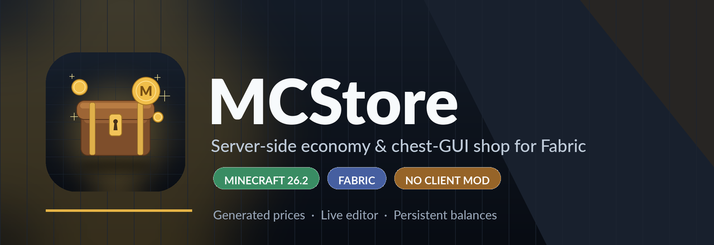
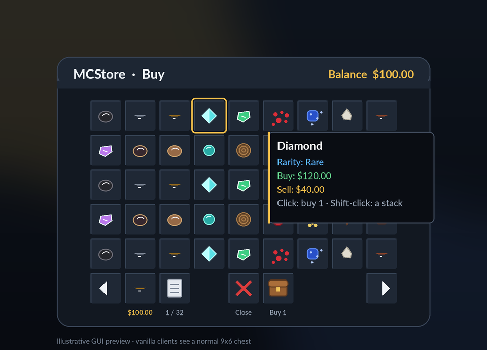
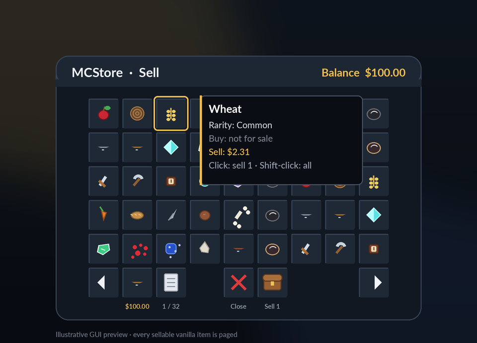
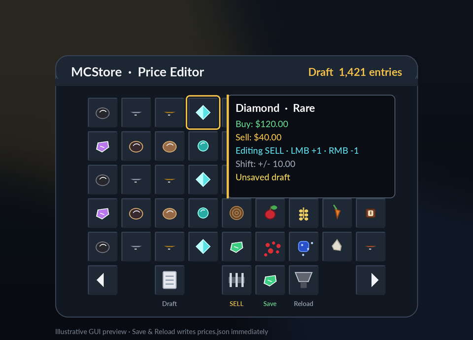

<p align="center">
  
</p>

<h1 align="center">MCStore</h1>

<p align="center">
  An economy and chest-GUI shop for Fabric that works in singleplayer worlds and on dedicated servers.<br>
  Buy ores and minerals, sell almost everything, and edit prices live. Vanilla clients can still join a server without the mod.
</p>

<p align="center">
  
  
  
  
</p>

---

## A shop that feels native

MCStore adds a small, focused economy to a Fabric world. Players open a normal chest interface, buy the ores and minerals they need, and sell the extra items they already have. Admins get a live price editor and a JSON price book that can be versioned, backed up, or generated once and edited by hand.

The same jar runs in **singleplayer worlds** (the integrated server) and on **dedicated servers**. There is no custom item, no custom block and no custom menu type: the shop uses Minecraft's own chest menu, so a vanilla client can join a server that has the mod and needs no downloads.

## Features

| | |
| --- | --- |
| **Chest-GUI shop** | `/buy` and `/sell` open a paged 9x6 chest. Every click is verified by the server. |
| **Buy ores and minerals** | Ores, raw materials, ingots, nuggets, scraps and useful mineral blocks are buyable. |
| **Sell almost everything** | Every non-blacklisted vanilla item gets a generated sell price, including blocks, tools, food and drops. |
| **Persistent economy** | Balances are stored as integer cents in `balances.json`, so there is no floating-point drift. |
| **Live admin editor** | `/mcstore edit` opens a draft editor with buy/sell switching, +/- buttons and Save & Reload. |
| **Immediate command edits** | `/mcstore setprice <item> <buy\|sell> <price>` writes the file and refreshes open shop views. |
| **Deterministic defaults** | The same item id always gets the same generated price, and prices stay inside their rarity band. |
| **Client + server** | One universal jar works in singleplayer and on servers. No registry content; remove the jar and the game is clean again. |
| **Small release** | The release JAR is well below 1 MB. |

## Preview

<p align="center">
  
  
</p>

<p align="center">
  
  <br>
  <sub>Illustrative interface previews. The real screens use Minecraft's vanilla chest interface.</sub>
</p>

## Requirements

| Component | Version |
| --- | --- |
| Minecraft | **26.2** |
| Fabric Loader | **0.20.1** or newer |
| Fabric API | **0.161.0+26.2** or newer for 26.2 |
| Java | **25** |

MCStore is built for the 26.2 line. The mod metadata declares `minecraft: "~26.2"`, so a 26.3 game will refuse to load it until a matching build is published.

## Installation

### Singleplayer / client

1. Install **Fabric Loader** for Minecraft **26.2** using the official installer.
2. Put **Fabric API** and **MCStore** into `.minecraft/mods/` (or your launcher profile's `mods/` directory).
3. Start the game and open or create a world. MCStore creates `config/mcstore/` and registers `/buy`, `/sell`, `/balance` and `/mcstore`.
4. Run `/buy` or `/sell` to open the shop. In a survival world without cheats, `/buy`, `/sell` and `/balance` still work; `/mcstore` needs cheats/op or a UUID in `admins.json`.

### Dedicated server

1. Install a Fabric server for Minecraft **26.2**. The official Fabric installer works:
   ```bash
   java -jar fabric-installer.jar server -mcversion 26.2 -loader 0.20.1 -downloadMinecraft
   ```
2. Put **Fabric API** and **MCStore** into the server's `mods/` directory.
3. Start the server. MCStore creates `config/mcstore/` and logs the command registration and price coverage.
4. Join as an operator (or add your UUID to `admins.json`) and run `/mcstore` to see the status.
5. Run `/buy` or `/sell` to open the shop.

No client-side installation is needed to join a server, but installing the same jar on the client enables the shop in singleplayer. The jar is one universal build, not separate client and server downloads.

## Commands

| Command | Who | Description |
| --- | --- | --- |
| `/buy` | Player | Open the buy GUI. |
| `/buy <item>` | Player | Buy one of a buyable item directly, for example `/buy minecraft:diamond`. |
| `/sell` | Player | Open the sell GUI. |
| `/sell hand` | Player | Sell the stack you are holding. |
| `/sell all` | Player | Sell every sellable item in your inventory. |
| `/balance` | Player | Show your balance. |
| `/mcstore` | Admin | Show coverage and status. |
| `/mcstore status` | Admin | Same as `/mcstore`. |
| `/mcstore setprice <item> <buy\|sell> <price>` | Admin | Set one price, write `prices.json` and refresh open views. |
| `/mcstore edit` | Admin, player | Open the live price editor. |
| `/mcstore reload` | Admin | Re-read `config.json`, `prices.json` and `admins.json`. |

Item arguments accept both `minecraft:diamond` and the short form `diamond`. Prices are decimal currency amounts with two decimals of precision, for example `55.00`.

### Permissions

- `/mcstore` and all of its subcommands require permission level **2** (GAMEMASTER), or a UUID listed in `config/mcstore/admins.json`.
- The server console always has access.
- `/buy`, `/sell` and `/balance` are for players; the console receives a clear error instead.
- `/mcstore edit` needs a player because it opens a chest GUI.

## Using the shop

### Buying

- Click an item to buy **one**.
- Shift-click to buy a full stack of that item.
- The purchase is checked in this order: price exists, item exists, balance is sufficient, inventory has room. Money is only withdrawn after those checks pass, and a failed inventory insert is refunded.
- The GUI displays the current balance on the gold ingot in the footer.

### Selling

- Click an item to sell **one**.
- Shift-click to sell **all of that item** currently in your inventory.
- `/sell hand` sells the held stack. `/sell all` walks the inventory and sells every item that has a price.
- Sale proceeds are credited immediately and the new balance is written to disk.

### Paging and navigation

The shop shows 45 entries per page. The bottom row holds the page arrows, balance, page number, close button and a short help icon. Display items cannot be removed: all clicks are intercepted by the server menu, and shift-click item movement is disabled.

## Prices and rarity

MCStore uses five rarity bands. Default sell prices are deterministic and stay inside the band. Generated buy prices are between **2x and 4x** the sell price; the multiplier rises with rarity.

| Rarity | Sell band | Default buy multiplier |
| --- | --- | --- |
| Common | 1.00 – 5.00 | 2.0x |
| Uncommon | 5.00 – 15.00 | 2.5x |
| Rare | 15.00 – 40.00 | 3.0x |
| Epic | 40.00 – 100.00 | 3.5x |
| Legendary | 100.00 – 250.00 | 4.0x |

On a clean Minecraft 26.2 server the generator produced:

- **1,421 prices**
- **1,421 of 1,421 filtered items (100%)**
- **1,421 of 1,537 registry items (92%)**
- **56 buyable ores and mineral entries**

Coverage is measured against the filtered set: every `minecraft:` item that is not intentionally blacklisted. Technical and creative-only items, spawn eggs, command and structure blocks, portals, bedrock, barriers, light blocks, budding amethyst and similar entries are excluded.

Generated prices are written once to `prices.json`. Existing files are loaded as-is on restart, so admin edits are not overwritten. If the file is empty or missing, defaults are generated again.

## Configuration

All files live in `config/mcstore/` relative to the server directory.

### `config.json`

```json
{
  "_comment": "MCStore server configuration. startingBalance is a decimal currency amount (for example 100.00); refreshOpenGuis updates open /buy and /sell views instantly.",
  "startingBalance": 100.00,
  "refreshOpenGuis": true
}
```

- `startingBalance` is used the first time a player's balance is requested. Changing it does **not** top up players who already have a ledger entry.
- `refreshOpenGuis: true` redraws open shop views after a price change. Set it to `false` if you prefer to close open shops when prices change.

### `prices.json`

```json
{
  "items": {
    "minecraft:diamond": {
      "rarity": "RARE",
      "buy": 120.00,
      "sell": 40.00
    },
    "minecraft:oak_log": {
      "rarity": "COMMON",
      "sell": 2.18
    }
  }
}
```

- `sell` is required for an item to be sellable.
- `buy` is optional. Omit it (or set it to `null`) to make an item **sell-only**.
- `rarity` is `COMMON`, `UNCOMMON`, `RARE`, `EPIC` or `LEGENDARY`. Case-insensitive names are accepted.
- Prices may be JSON numbers or decimal strings; both are converted to integer cents.
- After hand-editing, run `/mcstore reload` (or restart) so the server picks up the file.
- Backup this file before a large edit. It is the complete price book, not a patch.

### `admins.json`

```json
{
  "admins": [
    "069a79f4-44e9-4726-a5be-fca90e38aaf5"
  ]
}
```

Op level 2 already has access; this file adds extra UUIDs. The file also accepts a bare array. Run `/mcstore reload` after editing it.

### `balances.json`

```json
{
  "balances": {
    "069a79f4-44e9-4726-a5be-fca90e38aaf5": 10000
  }
}
```

Values are **integer cents** (`10000` = `100.00`). MCStore writes this file on every balance change and again on server shutdown. For a manual balance adjustment, stop the server first, edit the file, then start it again.

## Admin workflow

### Live editor

`/mcstore edit` opens a draft of the whole price book.

- Click the comparator to switch between editing **BUY** and **SELL** prices.
- Click an item with left mouse to add **1.00**; right mouse subtracts **1.00**.
- Hold shift to change the value by **10.00** per click.
- **Save & Reload** writes `prices.json` immediately and refreshes open `/buy` and `/sell` views.
- The hopper discards the draft and reloads the file from disk.
- The barrier closes the editor.

The draft is held in memory until you save, so you can adjust several prices before committing.

### Command edit

```mcfunction
mcstore setprice minecraft:diamond sell 55.00
mcstore setprice minecraft:diamond buy 165.00
mcstore reload
```

`setprice` writes immediately. Buy prices are only accepted for items in the buyable ore/mineral set; sell prices can be set for any registered item that already has a price entry.

## Persistence and backups

- Prices, balances, config and admins are plain JSON. They are deliberately readable and easy to diff.
- `balances.json` is written atomically after each change; a crash should not leave a half-written file.
- Back up `config/mcstore/` before changing prices, resetting an economy or moving a world.
- Removing the mod removes its commands and GUI. The JSON files remain and can be reused if the mod is installed again.

## Building from source

Requirements: JDK **25** and network access to the Fabric Maven repository.

```bash
./gradlew test
./gradlew build
```

The build produces `build/libs/MCStore-26.2.1.jar` (and a lowercase copy, `build/libs/mcstore-26.2.1.jar`). The jar is the only build output that should be published. It is a universal client + server mod (`environment: "*"`), so the same file goes into a client `mods/` folder or a server `mods/` folder.

### Tests

The repository contains unit tests for rarity bands, price generation, blacklist and buyable classification, coverage math, JSON price persistence, balance persistence, config parsing and the item-id command argument.

### Smoke test

`scripts/smoke-test.sh` builds the mod, downloads a Fabric 26.2 server and Fabric API into `build/smoke/` (ignored by Git), starts the server, runs commands from the console, stops it and verifies the log and generated files:

```bash
JAVA_HOME=/path/to/jdk-25 scripts/smoke-test.sh
```

The script checks that the mod initializes, the commands register, the 80% coverage target passes, `/mcstore setprice` writes the new price, `/mcstore reload` works and `prices.json`, `balances.json`, `config.json` and `admins.json` are created.

## Compatibility notes

- **Minecraft 26.2** only in this release.
- **Client + server**: one universal jar. Install it on the client for singleplayer and on the server for multiplayer; the same file works in both places.
- **Vanilla clients**: a client without the mod can still join a server that has it; the shop uses a vanilla chest menu and vanilla item components.
- **Other server-side mods** are generally fine. If another mod already registers `/buy`, `/sell`, `/balance` or `/mcstore`, the command trees may conflict; remove or rename one of them.
- The mod is not affiliated with Mojang Studios or Microsoft.

## FAQ

**Can a player take the display items out of the shop?**  
No. Every click is handled by the server menu, item movement is disabled, and the shop container is server-owned.

**Can a player buy with a full inventory?**  
The purchase is refused before money is withdrawn. If the final inventory insert unexpectedly fails, the cost is refunded.

**Where do I change prices?**  
Use `/mcstore edit`, `/mcstore setprice`, or edit `config/mcstore/prices.json` and run `/mcstore reload`.

**Why is an item missing from the shop?**  
It is either blacklisted as technical/creative-only, or there is no price entry for it. `/mcstore setprice` reports unknown items clearly.

**How do I reset the economy?**  
Stop the server, back up and replace or empty `config/mcstore/balances.json`, then start the server. New players receive `startingBalance`.

**Does it work on 26.3?**  
Not in this release. The mod metadata targets `~26.2`; a 26.3 build requires a new release.

## License

MIT. See [LICENSE](LICENSE).
